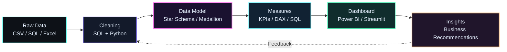

<!-- Save this as README.md inside a PUBLIC repo named exactly: Gayathri-Reddy874 -->

<p align="center">
  
</p>

<p align="center">
  <a href="https://readme-typing-svg.demolab.com">
    
  </a>
</p>

<p align="center">
  <picture>
    <source media="(prefers-color-scheme: dark)" srcset="https://raw.githubusercontent.com/Gayathri-Reddy874/Gayathri-Reddy874/output/github-contribution-grid-snake-dark.svg" />
    <source media="(prefers-color-scheme: light)" srcset="https://raw.githubusercontent.com/Gayathri-Reddy874/Gayathri-Reddy874/output/github-contribution-grid-snake.svg" />
    
  </picture>
</p>

<p align="center">
  <a href="https://github.com/Gayathri-Reddy874"></a>
  <a href="https://www.linkedin.com/in/mallareddygari-gayathri"></a>
  <a href="mailto:gayathrireddy18125@gmail.com"></a>
  <a href="https://leetcode.com/u/M-Gayathri-Reddy/"></a>
  <a href="https://huggingface.co/GayathriReddy96874"></a>
</p>

---

## About Me

I'm a **Data Analyst** based in Bangalore who turns raw, messy data into dashboards and insights that people can act on. I work across the full analytics workflow: **SQL cleaning and querying, dashboards and KPI reporting, Python EDA, and clear written insights**.

- B.E. in Artificial Intelligence & Machine Learning Engineering, **CGPA 9.07 / 10**.
- Currently working as a **Data Analyst – Apprentice at Colt Technology Services**, and previously a **Data Science Intern at Take It Smart (OPC) Pvt Ltd**.
- Built a **Medallion-architecture (Bronze → Silver → Gold) SQL data warehouse** that surfaced **$29.4M in total revenue** insights from bike sales data.
- Comfortable end to end: raw data, SQL cleaning, modelling, KPIs, dashboard, written recommendations.
- Looking for **full-time Data Analyst, Business Analyst and BI Analyst** roles. Data Scientist and AI/ML Engineer are my longer-term goals.
- First open-source contribution: a documentation PR to **MLflow** (#23551).

---

## Tech Stack

### Data Analysis & BI (core)


<!-- ✏️ Delete any badge above for a tool you haven't actually used. -->

### Python for Analytics


### Tools


### ML & AI (secondary)


---

## Featured Projects

### Data Analytics & BI

| | |
| --- | --- |
| **SQL Data Warehouse & Analytics**<br>Data warehouse on Medallion architecture (Bronze/Silver/Gold) with analytics on bike sales data, covering **$29.4M in total revenue**.<br>`SQL` `ETL` `Data Modeling`<br>[View Project](https://github.com/Gayathri-Reddy874?tab=repositories) | **Pizza Sales Analytics Dashboard**<br>Dashboard analysing sales trends, top products and peak periods, built for KPI tracking and business decisions.<br>`Dashboarding` `KPIs` `Data Visualization`<br>[View Project](https://github.com/Gayathri-Reddy874?tab=repositories) |
| **SegmentIQ: Customer Segmentation**<br>Customer segmentation that turns raw customer data into actionable groups for targeting.<br>`Python` `Pandas` `Scikit-learn`<br>[View Project](https://github.com/Gayathri-Reddy874?tab=repositories) | **Career-Guide App**<br>Career guidance web app deployed live on Render.<br>`Python` `Web App` `Render`<br>[View Project](https://github.com/Gayathri-Reddy874/Career-guide) |
<!-- ✏️ Add one real number to each card (rows analysed, revenue, orders, % improvement) and swap in the exact repo links. -->

### More Analytics Work

- **SmartLoan Predictor:** Flask loan-approval web app with a Random Forest model and rule-based scoring.
- **CineMatch:** movie recommender on the TMDB 5000 dataset (cosine similarity, Streamlit).
- **Folio:** book recommender using CountVectorizer and cosine similarity (Streamlit).

### AI / ML (secondary)

- **E-commerce Review Sentiment Analyzer:** DistilBERT on real Amazon reviews, class-imbalance handling, CI/CD and Docker.
- **Emotion AI App:** DistilRoBERTa emotion detection with 24 unit tests and Plotly visualizations.
- **Enterprise AI Assistant:** multi-agent RAG assistant (FastAPI, Streamlit, Pinecone, FAISS, AWS Bedrock, MySQL).
- **Transformer Playground:** seven Hugging Face tasks in one app, with Docker support.
- **LangChain + Groq Chatbot:** Streamlit chatbot with conversation memory, CI and Docker.

[](https://github.com/Gayathri-Reddy874?tab=repositories)

---

## GitHub Analytics

<p align="center">
  
  
</p>
<p align="center">
  
</p>

---

## How I Work: Analytics Workflow



- **SQL:** joins, aggregations, data standardisation, warehouse layers (Bronze/Silver/Gold).
- **Dashboards:** KPI design, cross-filtered views, business storytelling.
- **Python:** Pandas and NumPy wrangling, EDA, visualisation.
- **ML (secondary):** classification, NLP and recommender systems that extend the analysis.

---

## Experience

- **Data Analyst – Apprentice, Colt Technology Services** | *Start date – Present*
  - Working with real business data: SQL querying, analysis, dashboards and reporting.
  <!-- ✏️ Add your start date and 2-3 quantified bullets, e.g. "Built X dashboard used by Y team, cutting reporting time by Z%". -->

- **Data Science Intern, Take It Smart (OPC) Pvt Ltd** | *Start date – End date*
  - Hands-on work across the data science workflow: data handling, analysis and modeling.
  <!-- ✏️ Add 2-3 quantified bullets (projects delivered, tools used, results). -->

---

## Education & Certifications

- **B.E. in Artificial Intelligence & Machine Learning Engineering**, CGPA 9.07 / 10 <!-- ✏️ add college name and graduation month/year -->
- Microsoft Applied Skills credential
- Best Performer recognition
<!-- ✏️ List each certification by exact name and month/year, e.g. "AWS Cloud Practitioner Essentials (Aug 2026)". -->

---

## Contact

[](https://www.linkedin.com/in/mallareddygari-gayathri)
[](mailto:gayathrireddy18125@gmail.com)
[](https://github.com/Gayathri-Reddy874)

```
> Turning data into decisions, one insight at a time.
```

<p align="center">
  
</p>
