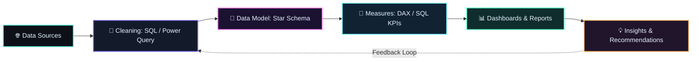

<p align="center">
  
</p>

<p align="center">
  <a href="https://git.io/typing-svg">
    
  </a>
</p>

<p align="center">
  <a href="https://github.com/Chowdri-Furkhan07"></a>
  <a href="https://www.linkedin.com/in/chowdri-furkhan"></a>
  <a href="mailto:mrfurkhanfurkhan@gmail.com"></a>
</p>

---

##  About Me

I turn raw, messy data into **dashboards, KPI reports and business insights** that teams can act on. My focus is the full analytics workflow, from **SQL cleaning and data modelling to Power BI dashboards and clear reporting**, with strong emphasis on **metric accuracy, clean data pipelines and storytelling with data**.

- Built SQL and Power BI analytics projects on retail, pizza sales and warehouse data, including a Medallion-architecture data warehouse covering **$29.4M+ in sales**.
- Deployed **20+ AI/ML and Generative AI projects** as a Data Science Intern, including dashboards, recommendation systems and chatbots.
- Skilled in SQL, Power BI, Tableau, Excel and Python, with ML and RAG applications as a secondary strength.

---

##  Tech Stack Grid

### Languages

    

### Data Analysis & BI

      

### Frameworks & Libraries

    

### AI / ML / GenAI (secondary)

  ![](https://img.shields.io/badge/OpenAI_API-0b0f1a?style=for-the-badge&logo=data:image/svg+xml;base64,PHN2ZyByb2xlPSJpbWciIHZpZXdCb3g9IjAgMCAyNCAyNCIgeG1sbnM9Imh0dHA6Ly93d3cudzMub3JnLzIwMDAvc3ZnIiBmaWxsPSIjN0RGOUZGIj48cGF0aCBkPSJNMjIuMiA5LjhhNS45IDUuOSAwIDAgMC0uNS00LjkgNi4wIDYuMCAwIDAgMC02LjUtMi45QTYuMCA2LjAgMCAwIDAgNC45IDQuMWE1LjkgNS45IDAgMCAwLTMuOSAyLjkgNi4wIDYuMCAwIDAgMCAuNyA3LjAgNS45IDUuOSAwIDAgMCAuNSA0LjkgNi4wIDYuMCAwIDAgMCA2LjUgMi45QTUuOSA1LjkgMCAwIDAgMTMuMiAyNGE2LjAgNi4wIDAgMCAwIDUuNy00LjIgNS45IDUuOSAwIDAgMCAzLjktMi45IDYuMCA2LjAgMCAwIDAtLjctNy4wem0tOS4wIDEyLjZhNC40IDQuNCAwIDAgMS0yLjgtMS4wbC4xLS4wIDQuNy0yLjdhLjcuNyAwIDAgMCAuMy0uNnYtNi43bDIuMCAxLjFhLjAuMCAwIDAgMSAuMC4wdjUuNWE0LjUgNC41IDAgMCAxLTQuNCA0LjR6bS05LjYtNC4xYTQuNCA0LjQgMCAwIDEtLjUtMy4wbC4xLjAgNC43IDIuN2EuNy43IDAgMCAwIC43IDBsNS44LTMuM3YyLjNhLjAuMCAwIDAgMS0uMC4wTDkuNyAxOS45YTQuNCA0LjQgMCAwIDEtNi4xLTEuNnpNMi4zIDcuOGE0LjQgNC40IDAgMCAxIDIuMy0xLjlWMTEuNmEuNy43IDAgMCAwIC4zLjZsNS44IDMuMy0yLjAgMS4xYS4wLjAgMCAwIDEtLjAgMGwtNC44LTIuN0E0LjUgNC41IDAgMCAxIDIuMyA3Ljh6bTE2LjUgMy44TDEzLjEgOC4zIDE1LjEgNy4yYS4wLjAgMCAwIDEgLjAgMGw0LjggMi43YTQuNCA0LjQgMCAwIDEtLjYgOC4xdi01LjZhLjcuNyAwIDAgMC0uNC0uNnptMi4wLTMuMGwtLjEtLjAtNC43LTIuN2EuNy43IDAgMCAwLS43IDBMOS40IDkuMlY2LjhhLjAuMCAwIDAgMSAuMC0uMGw0LjgtMi43YTQuNCA0LjQgMCAwIDEgNi42IDQuNnpNOC4zIDEyLjhsLTIuMC0xLjFhLjAuMCAwIDAgMS0uMC0uMFY2LjBhNC40IDQuNCAwIDAgMSA3LjMtMy40bC0uMS4wTDguNyA1LjRhLjcuNyAwIDAgMC0uMy42em0xLjAtMi4zbDIuNi0xLjQgMi42IDEuNHYyLjlsLTIuNSAxLjQtMi42LTEuNFoiLz48L3N2Zz4%3D)   ![](https://img.shields.io/badge/AWS_Bedrock-0b0f1a?style=for-the-badge&logo=data:image/svg+xml;base64,PHN2ZyByb2xlPSJpbWciIHZpZXdCb3g9IjAgMCAyNCAyNCIgeG1sbnM9Imh0dHA6Ly93d3cudzMub3JnLzIwMDAvc3ZnIiBmaWxsPSIjN0RGOUZGIj48cGF0aCBkPSJNNi43IDEwLjBjMCAuMi4wLjUuMC43LjAuMS4xLjMuMi41LjAuMC4wLjEuMC4xIDAgLjAtLjAuMS0uMS4ybC0uNS4zYS4zLjMgMCAwIDEtLjIuMGMtLjAgMC0uMS0uMC0uMi0uMWEyLjQgMi40IDAgMCAxLS4yLS4zIDYuMSA2LjEgMCAwIDEtLjItLjRjLS42LjctMS40IDEuMS0yLjMgMS4xLS42IDAtMS4yLS4xLTEuNS0uNS0uMy0uMy0uNS0uOC0uNS0xLjUgMC0uNi4yLTEuMi43LTEuNi40LS40IDEuMS0uNiAxLjktLjYuMiAwIC41LjAuOC4wLjIuMC42LjEuOS4xdi0uNWMwLS42LS4xLTEuMC0uMy0xLjItLjItLjItLjYtLjMtMS4zLS4zLS4yIDAtLjUuMC0uOC4xLS4yLjAtLjUuMS0uOC4yYTIuMiAyLjIgMCAwIDEtLjIuMS40LjQgMCAwIDEtLjEuMGMtLjEgMC0uMS0uMC0uMS0uMnYtLjNjMC0uMS4wLS4yLjAtLjJhLjUuNSAwIDAgMSAuMi0uMWMuMi0uMS42LS4yIDEuMC0uM2E0LjggNC44IDAgMCAxIDEuMi0uMWMuOSAwIDEuNi4yIDIuMC42LjQuNC42IDEuMC42IDEuOXYyLjV6bS0zLjIgMS4yYy4yIDAgLjUtLjAuOC0uMS4yLS4wLjUtLjIuNy0uNS4xLS4xLjItLjMuMi0uNS4wLS4xLjAtLjQuMC0uNnYtLjNhNi42IDYuNiAwIDAgMC0uNy0uMSA2LjAgNi4wIDAgMCAwLS43LS4wYy0uNSAwLS45LjEtMS4xLjMtLjIuMi0uMy41LS4zLjkgMCAuMy4wLjYuMi44LjEuMi40LjIuOC4yem02LjQuOGMtLjEgMC0uMi0uMC0uMy0uMC0uMC0uMC0uMS0uMS0uMS0uM0w3LjUgNS41YTEuMyAxLjMgMCAwIDEtLjAtLjNjMC0uMS4wLS4yLjEtLjJoLjdjLjEgMCAuMi4wLjMuMC4wLjAuMS4xLjEuM2wxLjMgNS4yIDEuMi01LjJjLjAtLjEuMC0uMi4xLS4zYS41LjUgMCAwIDEgLjMtLjBoLjZjLjEgMCAuMi4wLjMuMC4wLjAuMS4xLjEuM2wxLjIgNS4zIDEuMy01LjNjLjAtLjEuMS0uMi4xLS4zYS41LjUgMCAwIDEgLjMtLjBoLjdjLjEgMCAuMi4wLjIuMiAwIC4wLS4wLjAtLjAuMWExLjEgMS4xIDAgMCAxLS4wLjJsLTEuOSA2LjFjLS4wLjEtLjEuMi0uMS4zYS41LjUgMCAwIDEtLjMuMGgtLjZjLS4xIDAtLjItLjAtLjMtLjAtLjAtLjAtLjEtLjEtLjEtLjNsLTEuMi01LjEtMS4yIDUuMWMtLjAuMS0uMC4yLS4xLjMtLjAuMC0uMS4wLS4zLjB6bTEwLjIuMmMtLjQgMC0uOC0uMC0xLjItLjEtLjMtLjAtLjctLjItLjktLjMtLjEtLjAtLjItLjEtLjItLjJhLjUuNSAwIDAgMS0uMC0uMnYtLjRjMC0uMS4wLS4yLjEtLjIuMCAwIC4wLjAuMS4wLjAuMC4xLjAuMi4wLjIuMS41LjIuOC4yLjMuMC42LjAuOS4wLjUgMCAuOC0uMCAxLjEtLjJhLjguOCAwIDAgMCAuNC0uNy43LjcgMCAwIDAtLjItLjVjLS4xLS4xLS40LS4yLS44LS40bC0xLjEtLjNjLS41LS4xLTEuMC0uNC0xLjItLjhhMS45IDEuOSAwIDAgMS0uNC0xLjFjMC0uMy4wLS42LjItLjguMS0uMi4zLS40LjUtLjYuMi0uMS41LS4zLjgtLjQuMy0uMC42LS4xIDEuMC0uMS4xIDAgLjMuMC41LjAuMS4wLjMuMC41LjAuMS4wLjMuMC40LjEuMS4wLjIuMC4zLjFhLjYuNiAwIDAgMSAuMi4yLjQuNCAwIDAgMSAuMC4ydi4zYzAgLjEtLjAuMi0uMS4yYS44LjggMCAwIDEtLjMtLjAgMy42IDMuNiAwIDAgMC0xLjUtLjNjLS40IDAtLjguMC0xLjAuMi0uMi4xLS4zLjMtLjMuNyAwIC4yLjAuNC4yLjUuMS4xLjQuMy44LjRsMS4xLjNjLjUuMS45LjQgMS4yLjcuMi4zLjMuNy4zIDEuMSAwIC4zLS4wLjYtLjIuOS0uMS4yLS4zLjUtLjUuNy0uMi4yLS41LjMtLjguNC0uMy4xLS43LjEtMS4xLjF6TTIxLjYgMTYuMmMtMi42IDEuOS02LjQgMi45LTkuNyAyLjktNC41IDAtOC43LTEuNy0xMS44LTQuNS0uMi0uMi0uMC0uNS4yLS4zIDMuMyAxLjkgNy41IDMuMSAxMS44IDMuMSAyLjkgMCA2LjEtLjYgOS4wLTEuOC40LS4yLjguMi4zLjZ6TTIyLjcgMTQuOWMtLjMtLjQtMi4yLS4yLTMuMC0uMS0uMi4wLS4yLS4xLS4wLS4zIDEuNS0xLjAgMy45LS43IDQuMi0uMy4yLjMtLjAgMi44LTEuNCA0LjAtLjIuMS0uNC4wLS4zLS4xLjMtLjcgMS4wLTIuNS42LTIuOXoiLz48L3N2Zz4%3D)

### Databases

  

### Cloud & Tools

![](https://img.shields.io/badge/AWS-0b0f1a?style=for-the-badge&logo=data:image/svg+xml;base64,PHN2ZyByb2xlPSJpbWciIHZpZXdCb3g9IjAgMCAyNCAyNCIgeG1sbnM9Imh0dHA6Ly93d3cudzMub3JnLzIwMDAvc3ZnIiBmaWxsPSIjN0RGOUZGIj48cGF0aCBkPSJNNi43IDEwLjBjMCAuMi4wLjUuMC43LjAuMS4xLjMuMi41LjAuMC4wLjEuMC4xIDAgLjAtLjAuMS0uMS4ybC0uNS4zYS4zLjMgMCAwIDEtLjIuMGMtLjAgMC0uMS0uMC0uMi0uMWEyLjQgMi40IDAgMCAxLS4yLS4zIDYuMSA2LjEgMCAwIDEtLjItLjRjLS42LjctMS40IDEuMS0yLjMgMS4xLS42IDAtMS4yLS4xLTEuNS0uNS0uMy0uMy0uNS0uOC0uNS0xLjUgMC0uNi4yLTEuMi43LTEuNi40LS40IDEuMS0uNiAxLjktLjYuMiAwIC41LjAuOC4wLjIuMC42LjEuOS4xdi0uNWMwLS42LS4xLTEuMC0uMy0xLjItLjItLjItLjYtLjMtMS4zLS4zLS4yIDAtLjUuMC0uOC4xLS4yLjAtLjUuMS0uOC4yYTIuMiAyLjIgMCAwIDEtLjIuMS40LjQgMCAwIDEtLjEuMGMtLjEgMC0uMS0uMC0uMS0uMnYtLjNjMC0uMS4wLS4yLjAtLjJhLjUuNSAwIDAgMSAuMi0uMWMuMi0uMS42LS4yIDEuMC0uM2E0LjggNC44IDAgMCAxIDEuMi0uMWMuOSAwIDEuNi4yIDIuMC42LjQuNC42IDEuMC42IDEuOXYyLjV6bS0zLjIgMS4yYy4yIDAgLjUtLjAuOC0uMS4yLS4wLjUtLjIuNy0uNS4xLS4xLjItLjMuMi0uNS4wLS4xLjAtLjQuMC0uNnYtLjNhNi42IDYuNiAwIDAgMC0uNy0uMSA2LjAgNi4wIDAgMCAwLS43LS4wYy0uNSAwLS45LjEtMS4xLjMtLjIuMi0uMy41LS4zLjkgMCAuMy4wLjYuMi44LjEuMi40LjIuOC4yem02LjQuOGMtLjEgMC0uMi0uMC0uMy0uMC0uMC0uMC0uMS0uMS0uMS0uM0w3LjUgNS41YTEuMyAxLjMgMCAwIDEtLjAtLjNjMC0uMS4wLS4yLjEtLjJoLjdjLjEgMCAuMi4wLjMuMC4wLjAuMS4xLjEuM2wxLjMgNS4yIDEuMi01LjJjLjAtLjEuMC0uMi4xLS4zYS41LjUgMCAwIDEgLjMtLjBoLjZjLjEgMCAuMi4wLjMuMC4wLjAuMS4xLjEuM2wxLjIgNS4zIDEuMy01LjNjLjAtLjEuMS0uMi4xLS4zYS41LjUgMCAwIDEgLjMtLjBoLjdjLjEgMCAuMi4wLjIuMiAwIC4wLS4wLjAtLjAuMWExLjEgMS4xIDAgMCAxLS4wLjJsLTEuOSA2LjFjLS4wLjEtLjEuMi0uMS4zYS41LjUgMCAwIDEtLjMuMGgtLjZjLS4xIDAtLjItLjAtLjMtLjAtLjAtLjAtLjEtLjEtLjEtLjNsLTEuMi01LjEtMS4yIDUuMWMtLjAuMS0uMC4yLS4xLjMtLjAuMC0uMS4wLS4zLjB6bTEwLjIuMmMtLjQgMC0uOC0uMC0xLjItLjEtLjMtLjAtLjctLjItLjktLjMtLjEtLjAtLjItLjEtLjItLjJhLjUuNSAwIDAgMS0uMC0uMnYtLjRjMC0uMS4wLS4yLjEtLjIuMCAwIC4wLjAuMS4wLjAuMC4xLjAuMi4wLjIuMS41LjIuOC4yLjMuMC42LjAuOS4wLjUgMCAuOC0uMCAxLjEtLjJhLjguOCAwIDAgMCAuNC0uNy43LjcgMCAwIDAtLjItLjVjLS4xLS4xLS40LS4yLS44LS40bC0xLjEtLjNjLS41LS4xLTEuMC0uNC0xLjItLjhhMS45IDEuOSAwIDAgMS0uNC0xLjFjMC0uMy4wLS42LjItLjguMS0uMi4zLS40LjUtLjYuMi0uMS41LS4zLjgtLjQuMy0uMC42LS4xIDEuMC0uMS4xIDAgLjMuMC41LjAuMS4wLjMuMC41LjAuMS4wLjMuMC40LjEuMS4wLjIuMC4zLjFhLjYuNiAwIDAgMSAuMi4yLjQuNCAwIDAgMSAuMC4ydi4zYzAgLjEtLjAuMi0uMS4yYS44LjggMCAwIDEtLjMtLjAgMy42IDMuNiAwIDAgMC0xLjUtLjNjLS40IDAtLjguMC0xLjAuMi0uMi4xLS4zLjMtLjMuNyAwIC4yLjAuNC4yLjUuMS4xLjQuMy44LjRsMS4xLjNjLjUuMS45LjQgMS4yLjcuMi4zLjMuNy4zIDEuMSAwIC4zLS4wLjYtLjIuOS0uMS4yLS4zLjUtLjUuNy0uMi4yLS41LjMtLjguNC0uMy4xLS43LjEtMS4xLjF6TTIxLjYgMTYuMmMtMi42IDEuOS02LjQgMi45LTkuNyAyLjktNC41IDAtOC43LTEuNy0xMS44LTQuNS0uMi0uMi0uMC0uNS4yLS4zIDMuMyAxLjkgNy41IDMuMSAxMS44IDMuMSAyLjkgMCA2LjEtLjYgOS4wLTEuOC40LS4yLjguMi4zLjZ6TTIyLjcgMTQuOWMtLjMtLjQtMi4yLS4yLTMuMC0uMS0uMi4wLS4yLS4xLS4wLS4zIDEuNS0xLjAgMy45LS43IDQuMi0uMy4yLjMtLjAgMi44LTEuNCA0LjAtLjIuMS0uNC4wLS4zLS4xLjMtLjcgMS4wLTIuNS42LTIuOXoiLz48L3N2Zz4%3D)    

---

##  Featured Projects

<table>
  <tr>
    <td valign="top" width="50%">
      <h4>Blinkit Retail Intelligence Dashboard</h4>
      MySQL cleaning plus an interactive Power BI dashboard on <b>8,523 records</b>: <b>$1.20M</b> total sales and 3.9 average rating, sliced by item type, outlet tier and size.<br><br>
      <b>Stack:</b> <code>MySQL</code> <code>Power BI</code> <code>DAX</code> <code>Excel</code><br><br>
      <a href="https://github.com/Chowdri-Furkhan07/Blinkit-Retail-Intelligence-Dashboard"></a>
    </td>
    <td valign="top" width="50%">
      <h4>Pizza Sales BI Dashboard</h4>
      End-to-end analytics on <b>$817K+ revenue</b> and <b>21K+ orders</b>: customer behaviour, product performance and KPI-driven decision support.<br><br>
      <b>Stack:</b> <code>SQL</code> <code>Python</code> <code>Power BI</code><br><br>
      <a href="https://github.com/Chowdri-Furkhan07/pizza-sales-business-intelligence-dashboard"></a>
    </td>
  </tr>
  <tr>
    <td valign="top" width="50%">
      <h4>SQL Data Warehouse &amp; Analytics</h4>
      SQL Server data warehouse on Medallion architecture with star-schema modelling and analytics scripts, covering <b>$29.4M+ in sales</b>.<br><br>
      <b>Stack:</b> <code>T-SQL</code> <code>SQL Server</code> <code>ETL</code> <code>Star Schema</code><br><br>
      <a href="https://github.com/Chowdri-Furkhan07/sql-data-warehouse-analytics"></a>
    </td>
    <td valign="top" width="50%">
      <h4>Netflix Content Analytics Dashboard</h4>
      Interactive Power BI dashboard on movies vs TV shows, genres, ratings, countries and release trends.<br><br>
      <b>Stack:</b> <code>Power BI</code> <code>Data Visualization</code> <code>DAX</code><br><br>
      <a href="https://github.com/Chowdri-Furkhan07/Netflix-Content-Analytics-Dashboard"></a>
    </td>
  </tr>
  <tr>
    <td valign="top" width="50%">
      <h4>Global Health Expenditure Analysis</h4>
      Tableau dashboards, maps and stories comparing healthcare spending across nations and regions from 2000 to 2024.<br><br>
      <b>Stack:</b> <code>Tableau</code> <code>Data Storytelling</code><br><br>
      <a href="https://github.com/Chowdri-Furkhan07/global-health-expenditure-analysis-tableau"></a>
    </td>
    <td valign="top" width="50%">
      <h4>CustomerLens AI</h4>
      Customer segmentation with K-Means, Hierarchical, DBSCAN and GMM, plus Apriori-based recommendations in an interactive Streamlit app.<br><br>
      <b>Stack:</b> <code>Python</code> <code>Scikit-learn</code> <code>Apriori</code> <code>Streamlit</code><br><br>
      <a href="https://github.com/Chowdri-Furkhan07/CustomerLens-AI"></a>
    </td>
  </tr>
  <tr>
    <td valign="top" width="50%">
      <h4>Loan Eligibility Scorecard</h4>
      Explainable 100-point credit scorecard with EMI/FOIR affordability analysis and an optional ML approval probability.<br><br>
      <b>Stack:</b> <code>Python</code> <code>Scikit-learn</code> <code>Flask</code> <code>Docker</code><br><br>
      <a href="https://github.com/Chowdri-Furkhan07/loan-eligibility-scorecard"></a>
    </td>
    <td valign="top" width="50%">
      <h4>Auto MPG Analytics Platform</h4>
      End-to-end EDA, KPI monitoring and interactive dashboards with business intelligence insights.<br><br>
      <b>Stack:</b> <code>Python</code> <code>Plotly</code> <code>Streamlit</code> <code>Dash</code><br><br>
      <a href="https://github.com/Chowdri-Furkhan07/auto-mpg-analytics-platform"></a>
    </td>
  </tr>
</table>

<h3 align="center">🚀 All GitHub Projects</h3>

<p align="center">
  <a href="https://github.com/Chowdri-Furkhan07?tab=repositories"></a>
</p>

<p align="center">
  
  
</p>

---

##  GitHub Analytics

<p align="center">
  
  
</p>

<p align="center">
  
</p>

<p align="center">
  
</p>

---

##  Analytics & Data Expertise



- **SQL & Data Warehousing:** MySQL and SQL Server, joins and aggregations, Medallion architecture, star-schema modelling, ETL.
- **BI & Dashboards:** Power BI with Power Query and DAX, Tableau storytelling, Excel reporting, KPI tracking.
- **Python Analytics:** Pandas and NumPy wrangling, EDA, Matplotlib / Seaborn / Plotly visuals, Streamlit apps.
- **ML & GenAI:** customer segmentation, churn prediction, RAG apps with LangChain, FAISS and Pinecone, deployed with Flask, FastAPI and Docker.

---

##  Experience Timeline

- **Data Science Intern - Take It Smart (OPC) Pvt Ltd, Bengaluru, India** | *Feb 2026 - May 2026*
  - Deployed **20+ AI/ML and Generative AI projects**, including dashboards, recommendation systems and chatbots, using Python, SQL, Scikit-learn, TensorFlow, Flask, Streamlit, Power BI and OpenCV.
  - Developed Retrieval-Augmented Generation (RAG) and Generative AI applications using LangChain, FAISS, Pinecone, OpenAI/Groq APIs and AWS Bedrock, powering **10+ production-ready dashboards**.
  - Performed root cause analysis, data governance checks and end-to-end model deployment across multi-agent AI systems and business dashboards.

- **Job Simulation - Tata iQ (Forage), GenAI Powered Data Analytics** | *Aug 2026*  
Built a business summary report and an executive briefing deck on an AI-powered collections strategy, backed by a logistic regression delinquency prediction model.

---

##  Achievements & Certifications

- Microsoft Applied Skills: AI Research Agents (Jul 2026)
- Oracle Agentic AI Certified Foundations Associate (Jul 2026)
- GenAI Powered Data Analytics Job Simulation - Tata iQ, Forage (Aug 2026)
- AWS Cloud Practitioner Essentials - AWS Skill Builder (Aug 2026)
- AI Dashboards using Power BI - Skill Nation
- Getting Started with AI - IBM SkillsBuild
- Generative AI Workshop — OpenAI
- Responsive Web Design — freeCodeCamp

---

##  Contact Protocol

<div align="center">

[](https://www.linkedin.com/in/chowdri-furkhan) [](mailto:mrfurkhanfurkhan@gmail.com) [](https://github.com/Chowdri-Furkhan07)

[![](https://img.shields.io/badge/LeetCode-Profile-0b0f1a?style=for-the-badge&logo=data:image/svg+xml;base64,PHN2ZyByb2xlPSJpbWciIHZpZXdCb3g9IjAgMCAyNCAyNCIgeG1sbnM9Imh0dHA6Ly93d3cudzMub3JnLzIwMDAvc3ZnIiBmaWxsPSIjN0RGOUZGIj48cGF0aCBkPSJNMTMuNCAwYTEuMyAxLjMgMCAwIDAtLjkuNEw3LjEgNi4ybC0zLjggNC4xYTUuMiA1LjIgMCAwIDAtMS4yIDIuMSA1LjMgNS4zIDAgMCAwLS4xLjUgNS41IDUuNSAwIDAgMCAuMCAyLjMgNS44IDUuOCAwIDAgMCAuMyAxLjAgNS45IDUuOSAwIDAgMCAxLjIgMS44bDQuMiA0LjEuMC4wYzIuMiAyLjEgNS44IDIuMSA4LjAtLjBsMi4zLTIuM2MuNS0uNS41LTEuNC4wLTEuOWExLjMgMS4zIDAgMCAwLTEuOS0uMGwtMi4zIDIuM2EzLjAgMy4wIDAgMCAxLTQuMi4wbC0uMC0uMC00LjItNC4xYy0uNi0uNi0uOS0xLjQtLjktMi4yYTIuNiAyLjYgMCAwIDEgLjAtLjUgMi41IDIuNSAwIDAgMSAuNi0xLjFMOS4xIDguMWMxLjAtMS4xIDMuMi0xLjIgNC40LS4ybDMuNSAyLjhjLjUuNCAxLjQuMyAxLjktLjJhMS4zIDEuMyAwIDAgMC0uMi0xLjlsLTMuNS0yLjhjLS44LS42LTEuNy0xLjAtMi43LTEuMmwyLjAtMi4xQTEuMyAxLjMgMCAwIDAgMTMuNCAwem0tMi44IDEyLjhhMS4zIDEuMyAwIDAgMC0xLjMgMS4zIDEuMyAxLjMgMCAwIDAgMS4zIDEuM0gyMC43YTEuMyAxLjMgMCAwIDAgMS4zLTEuMyAxLjMgMS4zIDAgMCAwLTEuMy0xLjN6Ii8%2BPC9zdmc%2B&labelColor=05070d)](https://leetcode.com/u/xxZLSk0WXE/) [](https://huggingface.co/ChowdriFurkhan07)

</div>

```
> Turning data into decisions, one insight at a time.
> Building analytics that teams can trust and act on.
```
