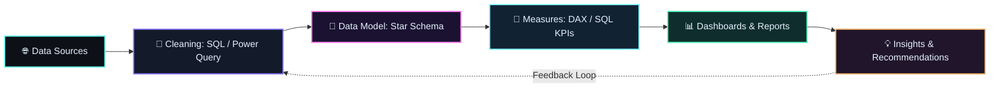

<p align="center">
  
</p>

<p align="center">
  <a href="https://git.io/typing-svg">
    
  </a>
</p>

<p align="center">
  <a href="https://github.com/Chowdri-Furkhan07"></a>
  <a href="https://www.linkedin.com/in/chowdri-furkhan"></a>
  <a href="mailto:mrfurkhanfurkhan@gmail.com"></a>
</p>

---

##  About Me

I turn raw, messy data into **dashboards, KPI reports and business insights** that teams can act on. My focus is the full analytics workflow, from **SQL cleaning and data modelling to Power BI dashboards and clear reporting**, with strong emphasis on **metric accuracy, clean data pipelines and storytelling with data**.

- Built SQL and Power BI analytics projects on retail, pizza sales and warehouse data, including a Medallion-architecture data warehouse covering **$29.4M+ in sales**.
- Deployed **20+ AI/ML and Generative AI projects** as a Data Science Intern, including dashboards, recommendation systems and chatbots.
- Skilled in SQL, Power BI, Tableau, Excel and Python, with ML and RAG applications as a secondary strength.

---

##  Tech Stack Grid

### Languages


### Data Analysis & BI

      

### Frameworks & Libraries


### AI / ML / GenAI (secondary)

     

### Databases

 

### Cloud & Tools


---

##  Featured Projects

| <h4>Blinkit Retail Intelligence Dashboard</h4>MySQL cleaning plus an interactive Power BI dashboard on **8,523 records**: **$1.20M** total sales and 3.9 average rating, sliced by item type, outlet tier and size.<br>**Stack:** `MySQL` `Power BI` `DAX` `Excel`<br>[](https://github.com/Chowdri-Furkhan07/Blinkit-Retail-Intelligence-Dashboard) | <h4>Pizza Sales BI Dashboard</h4>End-to-end analytics on **$817K+ revenue** and **21K+ orders**: customer behaviour, product performance and KPI-driven decision support.<br>**Stack:** `SQL` `Python` `Power BI`<br>[](https://github.com/Chowdri-Furkhan07/pizza-sales-business-intelligence-dashboard) |
| --- | --- |
| <h4>SQL Data Warehouse & Analytics</h4>SQL Server data warehouse on Medallion architecture with star-schema modelling and analytics scripts, covering **$29.4M+ in sales**.<br>**Stack:** `T-SQL` `SQL Server` `ETL` `Star Schema`<br>[](https://github.com/Chowdri-Furkhan07/sql-data-warehouse-analytics) | <h4>Netflix Content Analytics Dashboard</h4>Interactive Power BI dashboard on movies vs TV shows, genres, ratings, countries and release trends.<br>**Stack:** `Power BI` `Data Visualization` `DAX`<br>[](https://github.com/Chowdri-Furkhan07/Netflix-Content-Analytics-Dashboard) |
| <h4>Global Health Expenditure Analysis</h4>Tableau dashboards, maps and stories comparing healthcare spending across nations and regions from 2000 to 2024.<br>**Stack:** `Tableau` `Data Storytelling`<br>[](https://github.com/Chowdri-Furkhan07/global-health-expenditure-analysis-tableau) | <h4>CustomerLens AI</h4>Customer segmentation with K-Means, Hierarchical, DBSCAN and GMM, plus Apriori-based recommendations in an interactive Streamlit app.<br>**Stack:** `Python` `Scikit-learn` `Apriori` `Streamlit`<br>[](https://github.com/Chowdri-Furkhan07/CustomerLens-AI) |
| <h4>Loan Eligibility Scorecard</h4>Explainable 100-point credit scorecard with EMI/FOIR affordability analysis and an optional ML approval probability.<br>**Stack:** `Python` `Scikit-learn` `Flask` `Docker`<br>[](https://github.com/Chowdri-Furkhan07/loan-eligibility-scorecard) | <h4>Auto MPG Analytics Platform</h4>End-to-end EDA, KPI monitoring and interactive dashboards with business intelligence insights.<br>**Stack:** `Python` `Plotly` `Streamlit` `Dash`<br>[](https://github.com/Chowdri-Furkhan07/auto-mpg-analytics-platform) |

### 🚀 All GitHub Projects

[](https://github.com/Chowdri-Furkhan07?tab=repositories)

 

---

##  GitHub Analytics

   

---

##  Analytics & Data Expertise



- **SQL & Data Warehousing:** MySQL and SQL Server, joins and aggregations, Medallion architecture, star-schema modelling, ETL.
- **BI & Dashboards:** Power BI with Power Query and DAX, Tableau storytelling, Excel reporting, KPI tracking.
- **Python Analytics:** Pandas and NumPy wrangling, EDA, Matplotlib / Seaborn / Plotly visuals, Streamlit apps.
- **ML & GenAI:** customer segmentation, churn prediction, RAG apps with LangChain, FAISS and Pinecone, deployed with Flask, FastAPI and Docker.

---

##  Experience Timeline

- **Data Science Intern — Take It Smart (OPC) Pvt Ltd, Bengaluru, India** | *Feb 2026 – May 2026*
  - Deployed **20+ AI/ML and Generative AI projects**, including dashboards, recommendation systems and chatbots, using Python, SQL, Scikit-learn, TensorFlow, Flask, Streamlit, Power BI and OpenCV.
  - Developed Retrieval-Augmented Generation (RAG) and Generative AI applications using LangChain, FAISS, Pinecone, OpenAI/Groq APIs and AWS Bedrock, powering **10+ production-ready dashboards**.
  - Performed root cause analysis, data governance checks and end-to-end model deployment across multi-agent AI systems and business dashboards.

- **Job Simulation — Tata iQ (Forage), GenAI Powered Data Analytics** | *Aug 2026*  
Built a business summary report and an executive briefing deck on an AI-powered collections strategy, backed by a logistic regression delinquency prediction model.

---

##  Achievements & Certifications

- Microsoft Applied Skills: AI Research Agents (Jul 2026)
- Oracle Agentic AI Certified Foundations Associate (Jul 2026)
- GenAI Powered Data Analytics Job Simulation — Tata iQ, Forage (Aug 2026)
- AWS Cloud Practitioner Essentials — AWS Skill Builder (Aug 2026)
- AI Dashboards using Power BI — Skill Nation
- Getting Started with AI — IBM SkillsBuild
- Generative AI Workshop — OpenAI
- Responsive Web Design — freeCodeCamp

---

##  Contact Protocol

[](https://www.linkedin.com/in/chowdri-furkhan) [](mailto:mrfurkhanfurkhan@gmail.com) [](https://github.com/Chowdri-Furkhan07)

```
> Turning data into decisions, one insight at a time.
> Building analytics that teams can trust and act on.
```
