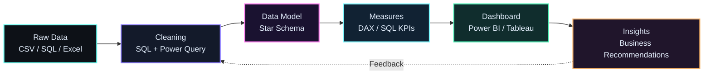

<p align="center">
  
</p>

<p align="center">
  <a href="https://git.io/typing-svg">
    
  </a>
</p>

<p align="center">
  <a href="https://github.com/Chowdri-Furkhan07"></a>
  <a href="https://www.linkedin.com/in/chowdri-furkhan/"></a>
  <a href="mailto:mrfurkhanfurkhan@gmail.com"></a>
  <a href="https://leetcode.com/u/xxZLSk0WXE/"></a>
  <a href="https://huggingface.co/ChowdriFurkhan07"></a>
</p>

---

## About Me

I'm a **Data Analyst** based in Bengaluru who turns raw, messy data into dashboards and insights that people can act on. I work across the full analytics workflow: **SQL cleaning and querying, Power BI modelling with DAX, Python EDA, and clear reporting**.

- B.E. in Artificial Intelligence & Machine Learning, Vijaya Vittala Institute of Technology (VVIT), Bengaluru. Graduated May 2026, CGPA 7.52.
- Built BI dashboards on retail, pizza sales and warehouse data, including a Medallion-architecture SQL data warehouse covering **$29.4M+ in sales**.
- Comfortable end to end: raw data, SQL cleaning, star-schema modelling, DAX KPIs, dashboard, written insights.
- Looking for **Data Analyst, Business Analyst, BI Analyst and Power BI Developer** roles. Data Scientist and AI/ML Engineer are longer-term goals.

---

## Tech Stack

### Data Analysis & BI (core)


### Python for Analytics


### Tools


### ML (secondary)


---

## Featured Projects

| **Blinkit Retail Intelligence Dashboard**<br>MySQL cleaning and aggregation plus an interactive Power BI dashboard across **8,523 records**: sales, ratings and outlet performance by item type, outlet tier and size. Total sales **$1.20M**, average rating **3.9**.<br>**Stack:** `MySQL` `Power BI` `DAX` `Excel`<br>[View Project](https://github.com/Chowdri-Furkhan07/Blinkit-Retail-Intelligence-Dashboard) | **SQL Data Warehouse & Analytics**<br>SQL Server T-SQL data warehouse built on Medallion architecture with star-schema modelling and analytics scripts for business insights. Analysis covers **$29.4M+ in sales**.<br>**Stack:** `T-SQL` `SQL Server` `ETL` `Star Schema`<br>[View Project](https://github.com/Chowdri-Furkhan07/sql-data-warehouse-analytics) |
| --- | --- |
| **Pizza Sales BI Dashboard**<br>End-to-end pizza sales analytics on **$817K+ revenue** and **21K+ orders**: customer behaviour, product performance and KPI-driven decision support.<br>**Stack:** `SQL` `Python` `Power BI`<br>[View Project](https://github.com/Chowdri-Furkhan07/pizza-sales-business-intelligence-dashboard) | **CustomerLens AI**<br>Customer segmentation with K-Means, Hierarchical, DBSCAN and GMM, with automatic model selection by silhouette score. Apriori association rules drive confidence-based recommendations in a Streamlit app.<br>**Stack:** `Python` `Scikit-learn` `MLxtend` `Streamlit`<br>[View Project](https://github.com/Chowdri-Furkhan07/CustomerLens-AI) · [Live Demo](https://customerlens-ai-tn5lg6yyvbi8fliyvqsz7f.streamlit.app/) |
| **Global Health Expenditure Analysis (2000–2024)**<br>Tableau dashboards, maps and stories comparing healthcare spending trends across nations and regions.<br>**Stack:** `Tableau` `Data Storytelling`<br>[View Project](https://github.com/Chowdri-Furkhan07/global-health-expenditure-analysis-tableau) | **Inventory Analytics Dashboard**<br>Python and Streamlit inventory system: product CRUD, stock monitoring, dashboards and CSV reporting.<br>**Stack:** `Python` `Streamlit` `Pandas`<br>[View Project](https://github.com/Chowdri-Furkhan07/inventory-analytics-dashboard) |
| **LinkedIn Analytics Pipeline**<br>Weekly data pipeline on real LinkedIn export files: star-schema SQLite model, idempotent Python ETL, SQL rollup views and a Power BI export layer.<br>**Stack:** `Python` `SQLite` `SQL` `Power BI`<br>[View Repositories](https://github.com/Chowdri-Furkhan07?tab=repositories) | **Intelligent Document RAG** *(AI/ML)*<br>Multi-document semantic search and answer generation with retrieval-augmented generation.<br>**Stack:** `LangChain` `Pinecone` `Groq LLaMA` `Streamlit`<br>[View Project](https://github.com/Chowdri-Furkhan07/Intelligent-Document-RAG) |
| **Netflix Content Analytics Dashboard**<br>Interactive Power BI dashboard on movies vs TV shows, genres, ratings, countries and release trends.<br>**Stack:** `Power BI` `Data Visualization`<br>[View Project](https://github.com/Chowdri-Furkhan07/Netflix-Content-Analytics-Dashboard) | **Auto MPG Analytics Platform**<br>EDA, KPI monitoring and business intelligence insights with interactive Streamlit and Dash dashboards.<br>**Stack:** `Python` `Plotly` `Streamlit` `Dash`<br>[View Repositories](https://github.com/Chowdri-Furkhan07?tab=repositories) |

[](https://github.com/Chowdri-Furkhan07?tab=repositories)

---

## GitHub Analytics

<p align="center">
  
  
</p>
<p align="center">
  
</p>

---

## How I Work: Analytics Workflow



- **SQL:** joins, aggregations, data standardisation, stored procedures (MySQL, MS SQL).
- **Power BI:** Power Query ETL, star-schema modelling, DAX measures, cross-filtered dashboards.
- **Python:** Pandas and NumPy wrangling, EDA, statistical analysis, Matplotlib and Seaborn visuals.
- **Reporting:** KPI tracking, MIS-style Excel reports, pivot tables, written business summaries.

---

## Experience

- **Data Science Intern, Take It Smart (OPC) Pvt Ltd** | *Feb 2026 – May 2026*
  <!-- TODO: add 2 bullets with real tasks and numbers, e.g. "Cleaned X rows and built Y model that did Z" -->

- **Job Simulation: GenAI Powered Data Analytics, Tata iQ (Forage)** | *Aug 2026*
  Built a business summary report and an executive briefing deck on an AI-powered collections strategy, backed by a logistic regression delinquency prediction model.

---

## Certifications

- Microsoft Applied Skills: AI Research Agents (Jul 2026)
- Oracle Agentic AI Certified Foundations Associate (Jul 2026)
- Tata iQ GenAI Powered Data Analytics Job Simulation, Forage (Aug 2026)
- AWS Cloud Practitioner Essentials, AWS Skill Builder (Aug 2026)
- AI Dashboards using Power BI, Skill Nation
- Getting Started with AI, IBM SkillsBuild
- Generative AI Workshop, OpenAI
- Responsive Web Design, freeCodeCamp

---

## Contact

[](https://www.linkedin.com/in/chowdri-furkhan/)
[](mailto:mrfurkhanfurkhan@gmail.com)
[](https://github.com/Chowdri-Furkhan07)

```
> Turning data into decisions, one insight at a time.
```
